<p align="center">
  
</p>

<h1 align="center">OpenGrab</h1>

<p align="center"><strong>A Better Internet Download Manager</strong></p>

<p align="center">
  Free and open source. No ads, no nag screens, no subscription.<br>
  Multi-connection downloads, a LinkGrabber that catches links from anywhere, captchas and Cloudflare handled,<br>
  BitTorrent, automation and remote control, in a classic desktop interface that stays out of your way.
</p>

<p align="center">
  <a href="https://github.com/TristinL6982/opengrab/actions/workflows/ci.yml"></a>
  <a href="https://github.com/TristinL6982/opengrab/releases"></a>
  
  
  
  <a href="LICENSE"></a>
</p>

<p align="center">
  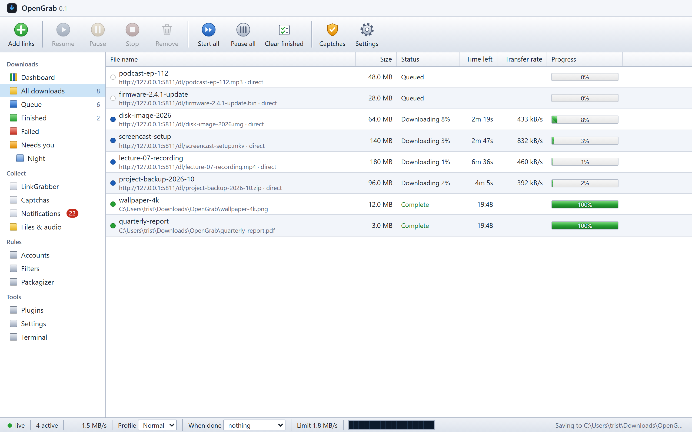
</p>

## Why OpenGrab

- **Fast where it counts.** Every download is split into up to 16 connections. When one connection slows down, the others take over its remaining range, so a single bad mirror never holds up the file.
- **Resumes anything.** Network drop, crash, shutdown or power cut: OpenGrab keeps a checkpoint next to the file and continues where it stopped, verifying that the remote file has not changed.
- **Catches links everywhere.** Paste them, copy them, drop them on the window, send them from the browser extension, use Click'n'Load buttons, crawl a page with the site spider, or drop a `.crawljob` file in a watched folder.
- **Handles the hard sites.** Cloudflare and DDoS-Guard checks, captchas, logins and premium accounts are part of the normal flow, not an error message.
- **Does the rest for you.** Extraction, checksums, virus scans, categories, renaming rules, scheduled speed windows, data caps, and "shut down when done".
- **Yours to run anywhere.** A Windows desktop app with a tray icon, or a headless server in Docker that you control from your phone, the command line, or scripts.
- **Light.** About 70 MB on disk, no bundled AI models, no GPU needed. Optional add-ons such as the local captcha solver are downloaded only when you turn them on.

## See it in action

Adding links and watching them download:

<p align="center">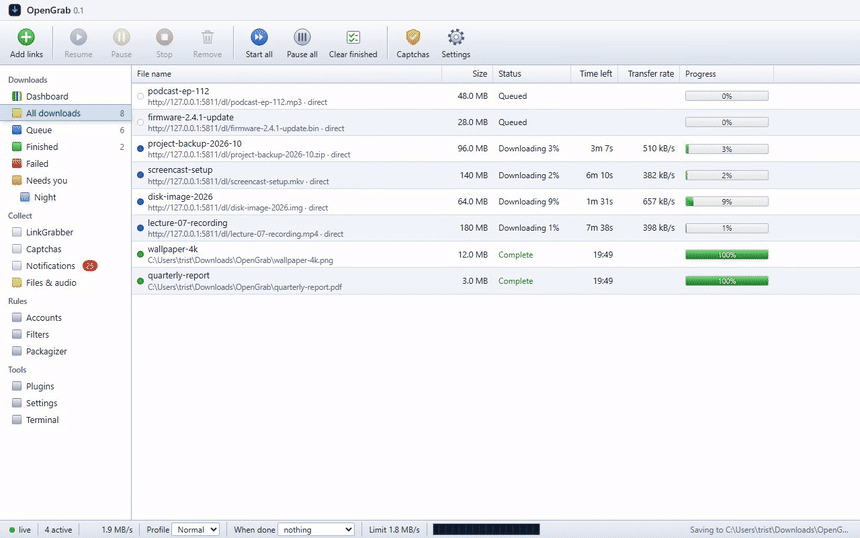</p>

The dashboard, the LinkGrabber, Settings and the dark theme:

<p align="center">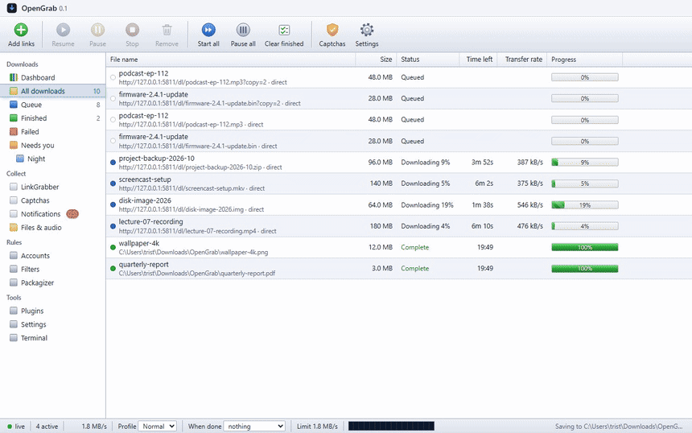</p>

An MP4 of the full tour is in [docs/media/tour.mp4](docs/media/tour.mp4).

## Install

### Windows

Download `OpenGrab-<version>-setup.exe` from the [latest release](https://github.com/TristinL6982/opengrab/releases/latest) and run it. The wizard lets you choose:

- the install folder (default `C:\Program Files\OpenGrab`),
- Start menu and desktop shortcuts,
- starting OpenGrab in the tray when you sign in,
- which links and files Windows should hand to OpenGrab: `magnet:` and `opengrab://` links, `.torrent`, `.crawljob` and `.dlc` files,
- an optional download of the small local captcha solver.

Your settings and queue live in `%APPDATA%\OpenGrab`. The uninstaller asks before deleting them.

Prefer no installer? Download `OpenGrab-<version>-win64.zip`, unpack it anywhere and run `OpenGrab.exe`.

Requirements: 64-bit Windows 10 or 11 and the Microsoft Edge WebView2 Runtime, which Windows 11 and recent Windows 10 installs already have. The first start of an unsigned build shows a SmartScreen warning: choose *More info*, then *Run anyway*.

### From source (Windows, Linux, macOS)

```bash
git clone https://github.com/TristinL6982/opengrab.git
cd opengrab
python -m venv .venv
.venv/Scripts/pip install -e .        # Linux and macOS: .venv/bin/pip
python -m opengrab                    # desktop window on Windows
python -m opengrab --headless         # API and web UI only, any platform
```

Python 3.12 or newer. On Linux and macOS the headless server and web UI are tested in CI; the native window and tray are Windows-only for now.

### Docker

Each release publishes an image to the GitHub Container Registry:

```bash
docker run -d --name opengrab -p 5678:5678   -v ./config:/config -v ./downloads:/downloads   ghcr.io/tristinl6982/opengrab:latest
```

Or build it yourself with Compose:

```bash
cp .env.example .env
docker compose up -d --build
```

The web UI is on port 5678. The API token is written to `./config/settings.json`. Keep the container behind an HTTPS reverse proxy or a private network: OpenGrab refuses plain HTTP from other machines unless you allow it in `.env`.

## Features

### Downloads

| | |
|---|---|
| **Multi-connection** | Up to 16 connections per file. The slowest segment is split while the download runs, the way IDM does it. |
| **Resume and recovery** | A checkpoint file next to every download. Resumes after crashes and power loss, and checks ETag and Last-Modified before continuing. Falls back to a single stream on servers that ignore ranges. |
| **Limits that follow your day** | Global and per-download speed limits, named speed profiles (Normal, Gaming, Night), scheduled windows, per-site connection limits, and a daily or monthly data cap. |
| **Queues and priorities** | Several queues with their own slot counts, priorities, per-queue pause, and a "when done" action: exit, sleep, hibernate or shut down. |
| **Media** | Video and audio from thousands of sites through yt-dlp, including HLS streams, playlists and channels with a review step before anything is queued. |
| **Checksums** | Pass a SHA-256 or MD5 with a link and OpenGrab verifies the file when it finishes. |
| **Keep the PC awake** | Prevents standby while downloads run, if you want it to. |

### Collecting links

| | |
|---|---|
| **LinkGrabber** | Links wait in a review list where each one is checked online first, with size and availability. Add them one by one or all at once. |
| **Clipboard** | Copy a link anywhere and it shows up for review. Never queued behind your back. |
| **Browser extension** | Chromium browsers (Chrome, Edge, Brave, Opera, Vivaldi): send a link, the page's links, selected text or a started browser download to OpenGrab. |
| **Click'n'Load** | Buttons on download pages hand their links to OpenGrab on port 9666, as they would to JDownloader. |
| **Site spider** | Crawl a page or a whole site to a chosen depth and pick the file types you want. |
| **Drag and drop** | Drop links or any text with links in it onto the window. |
| **Folder Watch** | Drop link lists or `.crawljob` files into a watched folder and they are picked up automatically. |
| **Link filters and Packagizer** | Block or allow links by pattern, and rename or sort downloads into folders with rules, with a live preview. |

### Difficult sites

| | |
|---|---|
| **Cloudflare and DDoS-Guard** | A challenge page is recognised and parked, one entry per site. Solve it once in your own Edge or Chrome and OpenGrab keeps the clearance for the other downloads. |
| **Captchas** | Image captchas are answered in the download's row or in the Captchas view. Optional solvers: a local OCR add-on (small, CPU only, downloaded on demand), audio challenges, and paid services (2captcha, CapMonster, CapSolver, NopeCHA) with your own key. |
| **Accounts** | Premium and free accounts per site, with daily quotas and parallel limits per account. Passwords are protected with Windows DPAPI and never shown again. |
| **Debrid services** | Real-Debrid and AllDebrid links are resolved through your account. |
| **Proxies and logins** | HTTP, HTTPS and SOCKS proxies, per-site or global, with failover. Basic and Digest logins for servers and proxies. |
| **Router reconnect** | Trigger a router reconnect for a fresh IP when a host says "wait 30 minutes". |

### Supported sites

Dedicated plugins, with official APIs where the host offers one:

| Kind | Sites |
|---|---|
| **File hosts** | GoFile, MediaFire, Mega, transfer.it, 1fichier, Rapidgator, Turbobit, Hitfile, FileKeeper, DataNodes, FuckingFast, VikingFile, Rootz, FileDitch, Buzzheavier, 1cloudfile, mdiaload, chomikuj.pl, pixeldrain, Google Drive, Dropbox, GitHub releases |
| **Video** | Mixdrop, plus thousands of video sites through yt-dlp (YouTube, Vimeo, Twitch, ...) |
| **Link lists** | PrivateBin pastes (decrypted locally with the key in the link), paste sites, pages that list many hoster links |
| **Torrents** | magnet links, `.torrent` files, 1337x, Rutor and Tapochek topic pages, zetrrent |
| **Other** | FTP and FTPS with resume, direct storage-server links copied from the browser, any page with file links |

A site that isn't listed still works when its page links to the file. Premium accounts are used automatically once you add them under Accounts. If a site stops working, [report it](https://github.com/TristinL6982/opengrab/issues/new/choose): most fixes are a small change to one plugin.

### BitTorrent

An optional libtorrent add-on, installed from Settings in one click, adds magnet links and `.torrent` files to the same queue: per-file selection and priorities, a built-in tracker list, UPnP and NAT-PMP port mapping, seeding limits by ratio or time, and the same speed profiles as everything else. Finished `.torrent` downloads can open themselves.

### After the download

| | |
|---|---|
| **Extraction** | ZIP, 7z and TAR archives are unpacked into their own folder, with a private password list for encrypted archives. RAR needs an `unrar` tool on your PATH. |
| **Virus scan** | Optional scan of every finished file with Windows Defender or any command-line scanner. |
| **VirusTotal** | Check finished files against about 70 antivirus engines with your free VirusTotal API key, automatically or with one click per download. Only the file's SHA-256 is sent unless you allow uploads of files VirusTotal has never seen. Flagged files can go straight to quarantine. |
| **Categories** | Video, Music, Documents, Archives and Programs go into their own folders if you want. |
| **Files and audio** | Browse the download folder from the app and play audio files right there. |

### Automation and remote control

| | |
|---|---|
| **Command line** | `opengrab add <link>`, `list`, `status`, `pause`, `resume`, `start`, `stop`, `remove`, `notifications`. Handy for scripts and AI agents. |
| **Run a program** | Start any program when a download finishes or fails, with the details in environment variables. |
| **Webhooks** | JSON posted to your own endpoints, signed with HMAC-SHA256. |
| **Headless and Docker** | The full web UI on a server, with a health check for your container platform. |
| **Pairing** | Pair phones, browsers and scripts with a one-time code. Each device gets its own revocable token that can manage downloads but never change settings. |

### The app itself

| | |
|---|---|
| **Classic look, modern build** | The layout you know from IDM and JDownloader 2: a toolbar, a category tree and a list with real progress bars. Light and dark themes, three row densities, your choice of columns and accent colour. |
| **Dashboard** | Today's totals, the last 14 days, a live transfer graph, what is downloading now and your busiest sites, in panels you can rearrange. |
| **Languages** | English and Simplified Chinese. Translations are plain JSON files, so adding a language is mostly translating. |
| **Accessibility** | Full keyboard control of the download list, spoken names for every control, visible focus, and WCAG AA colour contrast. |
| **Import from JDownloader 2** | Bring your download list, LinkGrabber links and main settings across in one step. JDownloader's files are never changed. |
| **Updates** | One click checks GitHub for a new release, verifies its signature, tests it, and installs it. The previous version is kept so you can go back. |
| **Plugins** | Declarative site templates in JSON, Python plugins for the rest, a permission system for what a plugin may reach, and a signed plugin catalog format. |

## Screenshots

| | |
|---|---|
| 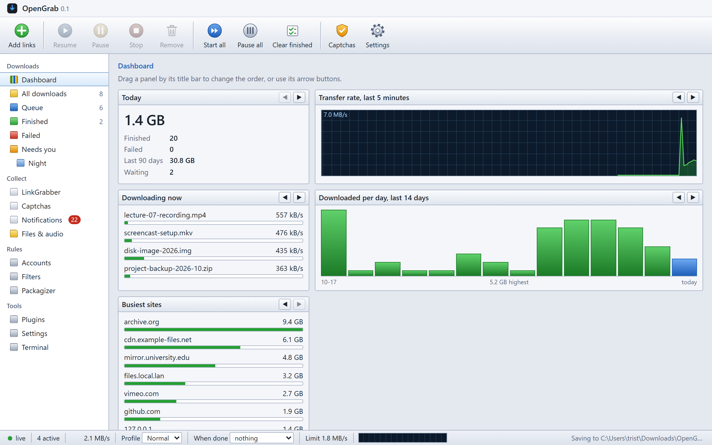 | 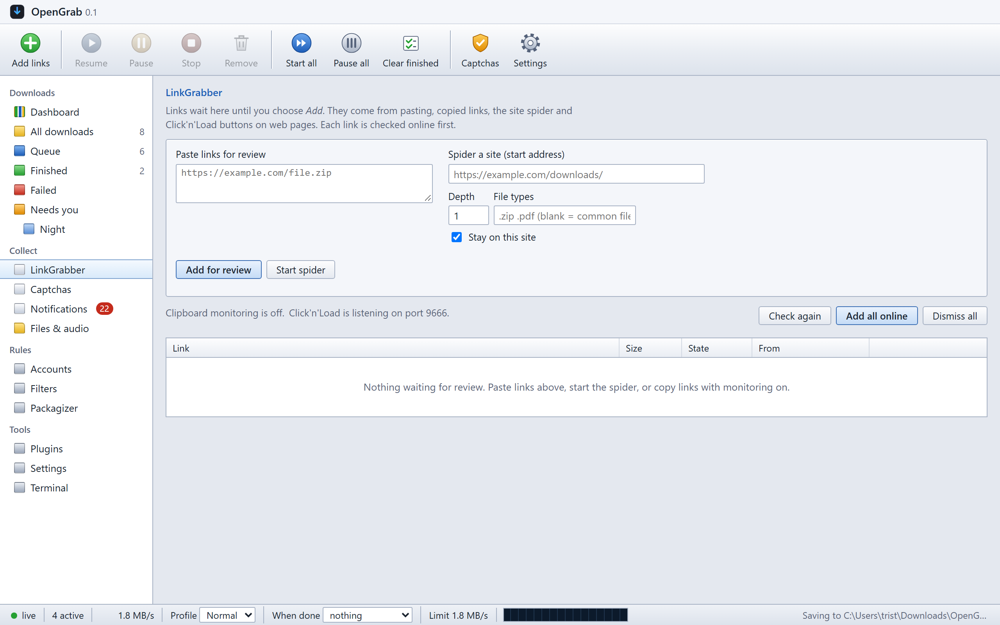 |
| Dashboard with the live transfer graph | LinkGrabber with online checks |
| 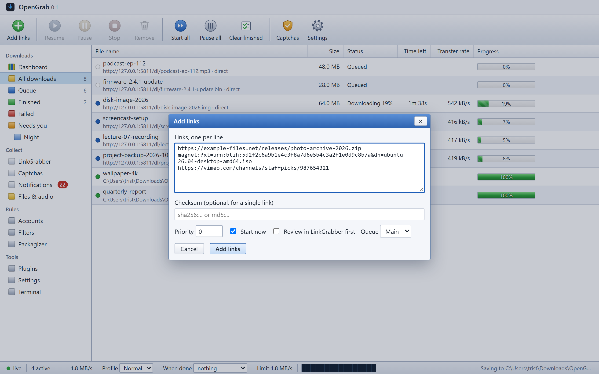 | 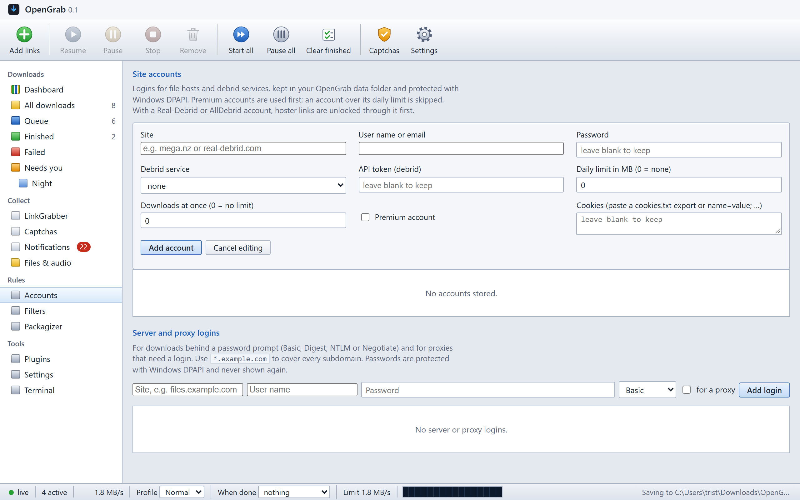 |
| Adding links with a checksum, priority and queue | Site accounts, server and proxy logins |
| 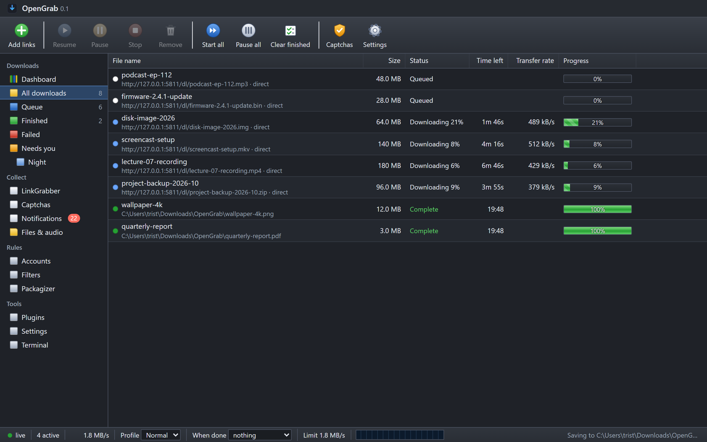 | 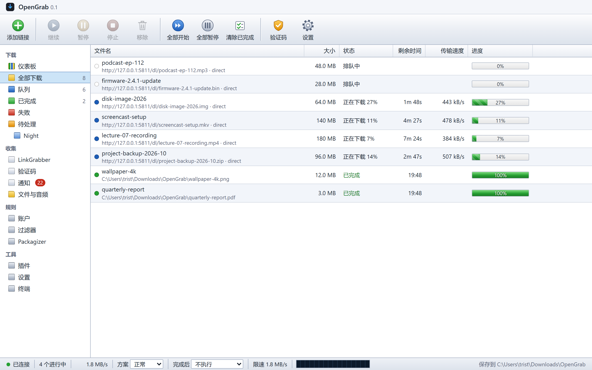 |
| The dark theme | Simplified Chinese |
| 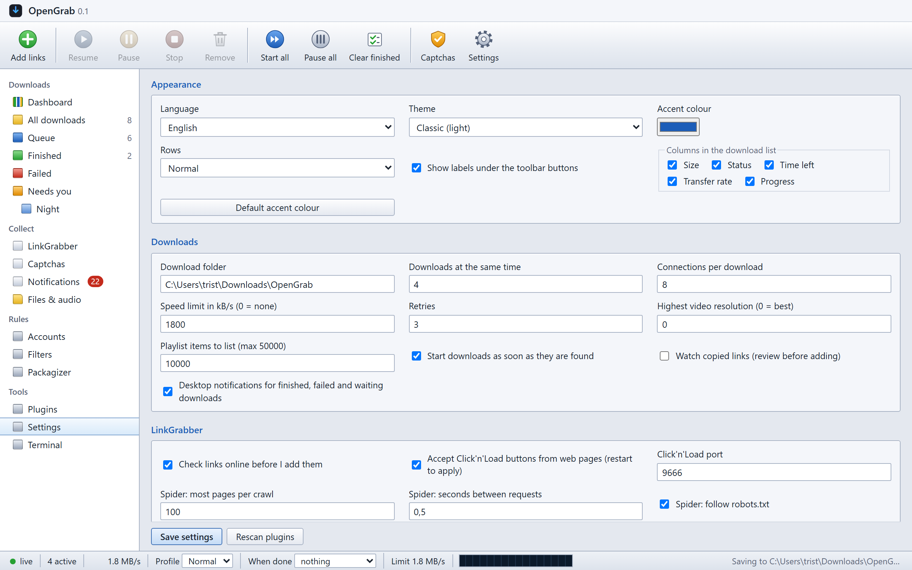 | 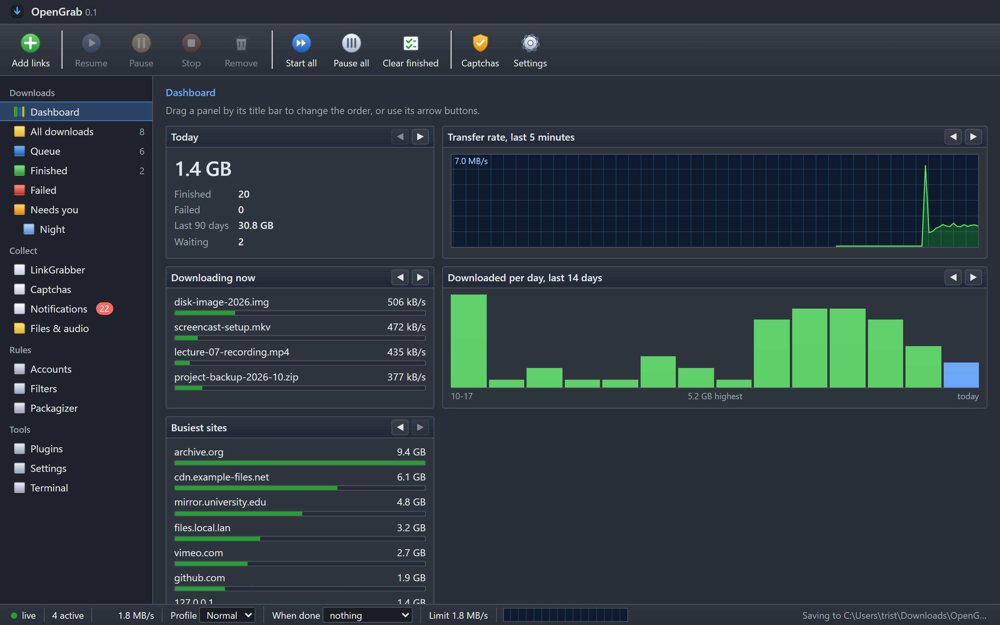 |
| Settings | The dashboard in the dark theme |

## Browser extension

The extension lives in [`extension/`](extension/). Until it is on the Chrome Web Store, load it unpacked:

1. Open `chrome://extensions` (or `edge://extensions`), turn on *Developer mode* and choose *Load unpacked*. Pick the `extension` folder.
2. In OpenGrab, open Settings, Paired devices, and pair a new device.
3. Paste the app address and the device token into the extension's options page.

From then on, right-click any link or page to send it to OpenGrab, and let the extension catch the downloads the browser would otherwise start itself.

## Command line

```bash
opengrab add https://example.com/big.iso --hash sha256:…
opengrab list
opengrab status
opengrab pause <id>
```

The command talks to the running app. Links, `magnet:` and `opengrab://` addresses and `.torrent` or `.crawljob` files given to `OpenGrab.exe` are opened in the running copy too, which is how Windows hands them over.

## How it compares

| | OpenGrab | Internet Download Manager | JDownloader 2 |
|---|---|---|---|
| Price | Free, open source | Paid licence | Free |
| Multi-connection downloads with dynamic splitting | Yes | Yes | Yes |
| LinkGrabber with online checks | Yes | No | Yes |
| Captcha and Cloudflare handling | Yes | No | Yes |
| BitTorrent | Add-on | No | No |
| Headless server, Docker, pairing for phones and scripts | Yes | No | Partial |
| Command line and webhooks | Yes | No | Partial |
| Runs without Java or a browser plugin | Yes | Yes | No |
| Disk footprint | About 70 MB | Small | Several hundred MB |

## Privacy and security

- Everything runs on your machine. OpenGrab contacts only the sites you download from, GitHub for update checks when you ask, and the services you configure yourself (captcha solvers, VirusTotal).
- The local API listens on `127.0.0.1` and needs a token on every request. Other machines get in only with a paired device token over HTTPS, or over plain HTTP if you allow it explicitly.
- Settings that make OpenGrab run programs (event hooks, reconnect scripts, scanner paths) can only be changed from the computer it runs on.
- Updates are installed only when their Ed25519 signature matches the key built into the app.

## Project status

OpenGrab is at version 0.1.0. Every feature above is covered by automated tests (over 900 of them, run on every push on Windows, Linux, macOS and in Docker), and the Windows build is installed, started and uninstalled by the pipeline before it is published.

Things that are built but not yet verified against the real world, and the decisions still open, are listed in [the project spec, section 9](docs/project-spec.md#9-open-decisions-and-known-gaps-recorded-2026-10-30). The current verified state is in [docs/progress.md](docs/progress.md). Bug reports with a link that misbehaves are the most useful thing you can send.

## Contributing

OpenGrab is built in the open and gets better with every site template, translation and bug report. You don't need to be a Python expert to help:

- **Found a link that doesn't work?** [Open a bug report](https://github.com/TristinL6982/opengrab/issues/new/choose) with the link and the diagnostics file. That alone is a big help.
- **Know a file host well?** Most sites need only a small JSON template, no Python. [Request support for a site](https://github.com/TristinL6982/opengrab/issues/new/choose) or add the template yourself.
- **Speak another language?** Translations are a single JSON file.
- **Want to write code?** Look for issues labelled [good first issue](https://github.com/TristinL6982/opengrab/labels/good%20first%20issue), or pick anything from the [open decisions and known gaps](docs/project-spec.md#9-open-decisions-and-known-gaps-recorded-2026-10-30).

Read the [contributor guide](.github/CONTRIBUTING.md) before your first pull request: it explains the setup, the tests that must pass, and the few rules for site support. Security problems go through the [security policy](.github/SECURITY.md), not public issues.

If OpenGrab saves you time, a star on this repository helps other people find it.

## Development

```bash
.venv/Scripts/python.exe -m pytest -q -p no:cacheprovider
cd build && ../.venv/Scripts/python.exe -m PyInstaller --clean --noconfirm --distpath release OpenGrab.spec
build/release/OpenGrab/OpenGrab.exe --smoke-test
```

The code is plain Python 3.12 with a vanilla JavaScript UI and no build step. Site support is reimplemented from public site behaviour; nothing is ported from other download managers.

## License

OpenGrab is released under the [MIT License](LICENSE). Site support is written from public site behaviour; no code is taken from other download managers. yt-dlp and libtorrent keep their own licences.
